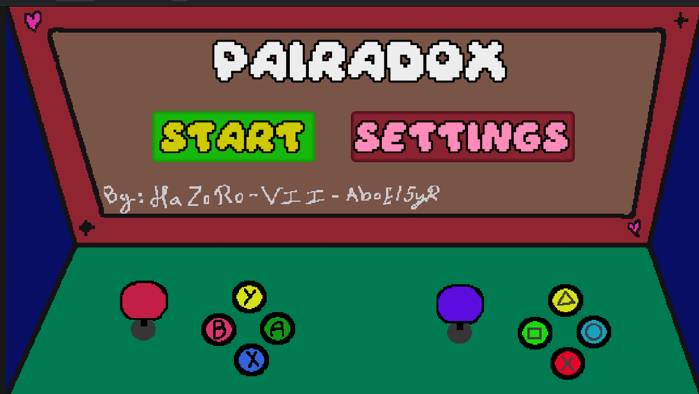
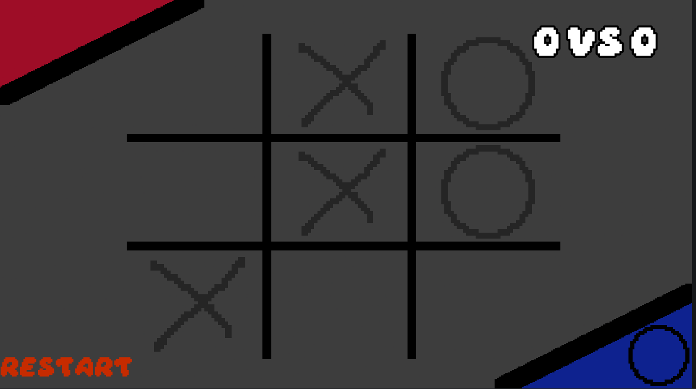
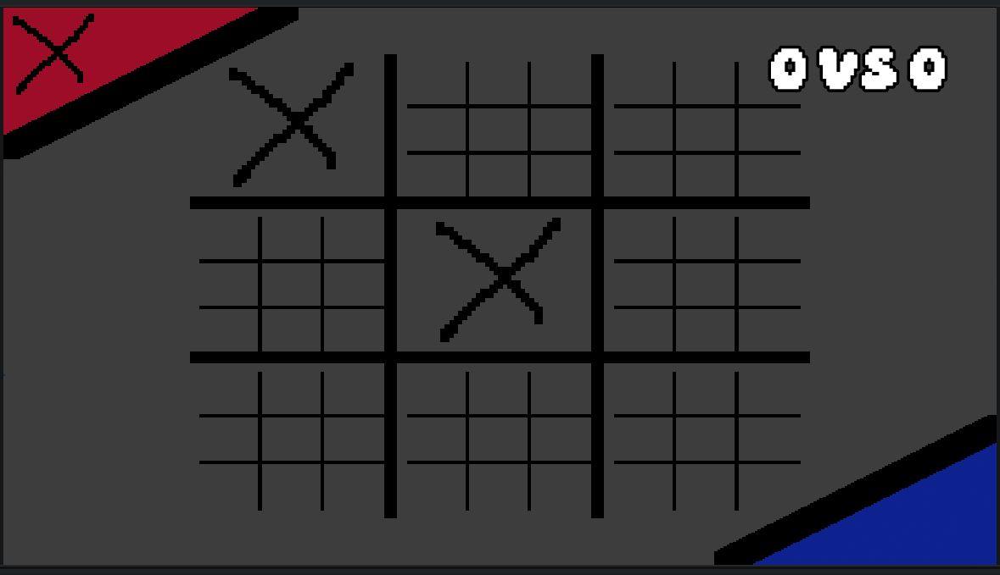
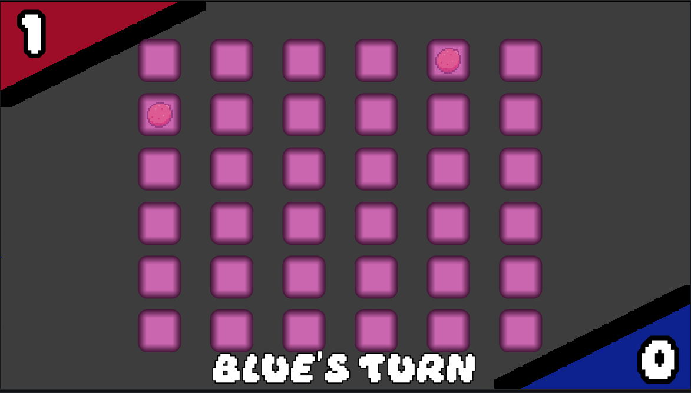
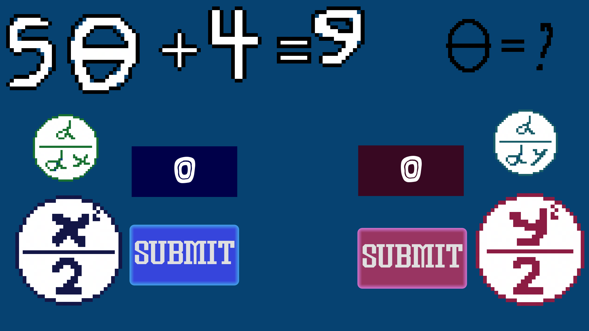

# Pairadox, A pair in a paradox ?
## Couch 1v1 game by [Hazoro](https://github.com/hazorox), [Vii](https://github.com/vii-abdullatif), and [AboEl5yr](https://github.com/AdhamMohamedKhairy)
### Live on [Itch.io](https://hazoro.itch.io/pairadox)



# Plot
You and your rival, your pair, are in a paradox and will have to play together in person :O

So why not have fun ? Play some minigames our team, batatis, tailored for you !!

# Minigames
## TicTacToe
What beats a classic ? An updated version :P

Enjoy two modes of tictactoe: normal and ULTIMATE (makes you a BIG SHOT)





## Memory Pairs

WARNING !!! VERY HARD

Match pairs :P


## Maths? Who invited bro
our maths freak wanted it :sob: @AboEl5yr

each player can increment or decrease their answer by up and down controls



# Controls
- Player 1 movement : wasd
- Player 1 interaction : E
- Player 2 movement : arrows
- Player 2 interaction : Enter
- Pause : Escape

# Setup from source
```sh
git clone https://github.com/vii-abdullatif/Pairadox
cd Pairadox # And open folder with Godot 4.7
```

# AI-Usage (Hazoro-Claude)
- Guidance with dimensions bug in ultimate tictactoe
- Help manage fruit textures loading and randomizing in memory picker
- Help manage canvas layers ordering
- Further minor usage

# Made with Luv, go try it out now !! [here](https://hazoro.itch.io/pairadox)